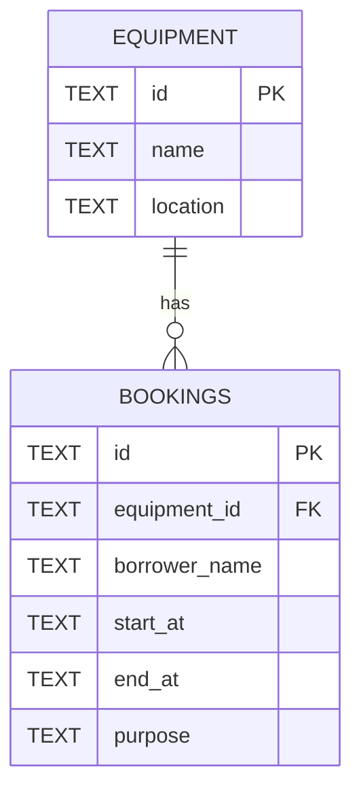

# Database Schema and ERD

The API uses Cloudflare D1, which is SQLite-compatible.

## ERD



## Tables

### equipment

| Column | Type | Constraints | Description |
| --- | --- | --- | --- |
| `id` | `TEXT` | Primary key | Equipment identifier, such as `eq-1` |
| `name` | `TEXT` | Not null | Equipment name |
| `location` | `TEXT` | Not null | Equipment location |

Seed records:

| id | name | location |
| --- | --- | --- |
| `eq-1` | Projector A | Building 1 |
| `eq-2` | Camera A | Building 2 |

### bookings

| Column | Type | Constraints | Description |
| --- | --- | --- | --- |
| `id` | `TEXT` | Primary key | Generated booking UUID |
| `equipment_id` | `TEXT` | Not null, foreign key | References `equipment(id)` |
| `borrower_name` | `TEXT` | Not null | Person borrowing the equipment |
| `start_at` | `TEXT` | Not null | ISO 8601 UTC start time |
| `end_at` | `TEXT` | Not null | ISO 8601 UTC end time |
| `purpose` | `TEXT` | Not null | Reason for the booking |

The `bookings_equipment_time_idx` index supports lookups by equipment and time range. The API prevents overlapping bookings with this condition:

```text
existing.start_at < new.end_at
AND existing.end_at > new.start_at
```

This treats booking intervals as half-open: a booking ending at `11:00` does not conflict with another booking starting at `11:00`.

The executable SQL is in [schema.sql](schema.sql).
